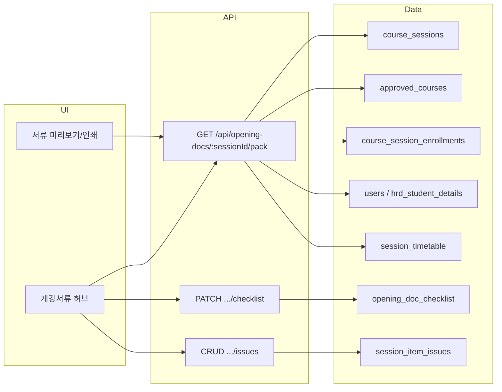

# 개강서류 준비·출력 기능 개발 계획서

| 항목 | 내용 |
|------|------|
| 문서 버전 | 1.0 |
| 작성일 | 2026-11-16 |
| 대상 | 관리자(원장) 대시보드 |
| 관련 회차 | `course_sessions` + 배정 수강생 |
| 상태 | 진행 중 — 메뉴·허브·D00/D01 1차 구현 |

---

## 1. 배경과 목표

과정(회차)이 **모집 → 개강**으로 전환될 때, 원장은 훈련생 하위 행정 서류를 일괄 준비·인쇄해야 한다.  
현재는 폴더에 있는 양식(한글/엑셀)을 수동으로 채우는 방식이며, LMS에는 **출석부·시간표 인쇄만** 존재하고 개강서류 팩은 없다.

### 목표

1. **회차 단위**로 개강서류 허브를 제공한다.
2. 회차·승인과정·수강생·시간표·교재 데이터를 **자동 기입**한다.
3. 서류별 **미리보기 → 인쇄(PDF 저장)** 및 (필요 시) **엑셀 다운로드**를 지원한다.
4. 수거·서명·지급 여부를 **체크리스트로 추적**해 개강 준비 완료도를 보이게 한다.

### 비목표 (1차 범위 제외)

- HWP 원본 바이너리 생성·편집
- 전자서명(공동인증/카카오 등) 연동
- 수강생 셀프 서명 포털 (2차 검토)
- 만족도조사·수업사진 폴더 자동화 (개강 이후 영역)

---

## 2. 대상 서류 (훈련생 하위)

첨부 폴더 기준 1차 대상 목록이다.

| 코드 | 서류명 | 유형 | 1차 우선순위 |
|------|--------|------|-------------|
| D00 | 훈련생 등록현황 체크리스트 | 명단+체크 | P0 |
| D01 | 훈련생명단(훈련교사관리) | 명단 | P0 |
| D02 | 수강생 배포용 시간표 | 시간표 | P0 (기존 출력 재사용) |
| D22 | 내일배움 훈련생서약서 | 개인 양식 | P1 |
| D23 | 개인정보활용동의서(일반) | 개인 양식 | P1 |
| D31 | 오리엔테이션 수거용 | 안내+서명 | P1 |
| D32 | 오리엔테이션 배포용 | 안내문 | P1 |
| D33 | 오리엔테이션 참여자명단 | 명단+체크 | P1 |
| D40 | 미디어 촬영 동의서 | 개인 양식 | P1 |
| D51 | 출석부(일반수강생용) | 출석 | P0 (기존 출력 재사용) |
| D52 | 출석부(전체·훈련교사관리) | 출석 | P0 (기존 출력 재사용) |
| D53 | 출석입력요청대장(별지 제16호) | 대장 | P2 |
| D70 | 교재지급대장 | 지급 대장 | P1 |
| D80 | SD카드 지급·반납 확인서 관리대장 | 지급 대장 | P1 |

---

## 3. 현황 (As-Is)

### 이미 있는 것

| 영역 | 위치 | 비고 |
|------|------|------|
| 회차·승인과정 | `course_sessions`, `approved_courses`, `/admin/courses/*` | 과정명·기간·강사·장소·정원 |
| 수강생 배정 | `course_session_enrollments` + `/api/course-sessions/:id/enrollments` | 이름·연락처 중심 |
| 훈련생 행정 플래그 | `hrd_student_details` (`has_application`, `has_card`, `is_hrd_net_registered`) | 등록 체크리스트 일부만 |
| 시간표 출력 | `/admin/courses/sessions/:id/timetable/print` | HTML + `window.print()` |
| 출석부 출력 | `/admin/attendance/print`, `/print/trainee` + HRD API | HTML + `window.print()` |
| 물품·대여 | `hrd_items`, `hrd_item_rentals` | 회차·수강생 지급대장과는 미연결 |
| 교재 마스터 | `approved_courses.textbook_ids_json`, `hrd_items` | 수강생별 지급일·서명 없음 |

### 없는 것

- 개강서류 메뉴·회차 허브 페이지
- 서약서·동의서·오리엔테이션 템플릿/스키마
- 교재·SD **회차×수강생 지급대장**
- 서류 준비 완료도(체크리스트) 저장
- 서버 PDF/HWP 엔진 (의도적으로 1차는 HTML 인쇄 채택)

---

## 4. 제안 UX / 화면

### 진입점

1. **회차 목록** (`/admin/courses` 또는 `/admin/courses/sessions`)  
   → 각 행 액션: **개강서류**
2. **직접 URL**  
   → `/admin/courses/sessions/:sessionId/opening-docs`
3. (선택) 모집 마감·개강 D-7 알림 배지: “서류 미완료 N건”

### 허브 화면 구성 (벤토 그리드)

```
┌─────────────────────────────────────────────────────────┐
│ 개강서류 준비 · [과정명] (N회차)                          │
│ 개강일 · 정원 · 배정인원 · 준비완료도 00%                  │
├──────────────┬──────────────┬──────────────┬────────────┤
│ 등록체크리스트│ 명단         │ 배포 시간표  │ 출석부     │
│ 미리보기/인쇄 │ 미리보기/인쇄│ 바로가기     │ 바로가기   │
├──────────────┴──────────────┴──────────────┴────────────┤
│ 개인 양식 (서약·개인정보·촬영·OT)                         │
│  [일괄 인쇄] [수강생별 인쇄] [수거 체크]                   │
├─────────────────────────────────────────────────────────┤
│ 지급 대장 (교재 / SD카드)                                 │
│  [대장 작성] [미리보기] [인쇄]                            │
└─────────────────────────────────────────────────────────┘
```

### 인쇄 흐름

1. 서류 카드 클릭 → **미리보기 탭/창**
2. 상단 **인쇄하기** (`window.print()`, 기존 출석·시간표와 동일)
3. 필요 시 **엑셀(.csv UTF-8 BOM)** — 명단·대장·시간표

개인 양식(서약서 등)은:

- **일괄**: 수강생마다 페이지 나누기(`page-break-after`)로 한 번에 출력
- **단건**: 수강생 선택 후 1장 출력

---

## 5. 아키텍처



### 기술 선택 (권장)

| 항목 | 선택 | 이유 |
|------|------|------|
| 출력 | HTML 템플릿 + `window.print()` | 기존 패턴 재사용, Cloudflare Workers에 PDF 엔진 부담 없음 |
| 엑셀 | CSV BOM (기존 과정/성적과 동일) | 의존성 없이 Excel 호환 |
| 템플릿 본문 | DB 또는 코드 상수(`opening_doc_templates`) | 기관 문구 수정 가능 |
| HWP | 1차 제외 → “양식 대조 후 HTML로 동일 레이아웃” | 브라우저/Workers에서 HWP 생성 비현실적 |
| 권한 | `admin` (+ 필요 시 `director`) | 원장·관리자만 |

---

## 6. 데이터 매핑

### 공통 헤더 필드 (모든 서류)

| 출력 항목 | 소스 |
|-----------|------|
| 훈련기관명 | 설정/고정 상수 (예: 와우쓰리디·3DCookieHD) |
| 훈련과정명 | `approved_courses.name` + 회차명/회차번호 |
| 회차 | `course_sessions.session_number` |
| 훈련기간 | `training_start_date` ~ `training_end_date` |
| 훈련시간 | `training_time_start/end`, `days_of_week` |
| 강의실/장소 | `location` |
| 훈련교사 | `instructor_name` (+ 시간표 강사) |
| 작성일 | 출력 시점(KST) |

### 서류별 상세

| 코드 | 자동 기입 | 신규/확장 필요 |
|------|-----------|----------------|
| D00 | 명단 + 신청서/카드/HRD-Net 플래그 | 개강서류별 수거 체크 컬럼 |
| D01 | 이름, 연락처, 생년월일, 성별, 주소, 유형 | enroll 조인에 birthdate/address 포함 |
| D02 | 기존 시간표 출력 | 배포용 문구/헤더만 통일 |
| D22/D23/D40 | 성명·과정·기간 | 동의/서명란(수기), 템플릿 문구 |
| D31~D33 | 과정 정보·명단 | OT 일시/장소/아젠다 필드, 참석 체크 |
| D51/D52 | 기존 출석 인쇄 API | 허브에서 딥링크 |
| D53 | 훈련일 목록 | 별지 제16호 레이아웃·요청 상태 |
| D70 | 과정 교재 목록 × 수강생 | `session_item_issues` (지급일·서명·비고) |
| D80 | SD 품목 × 수강생 | 동일 테이블, item_type=`sd_card` |

### 권장 신규 스키마 (초안)

```sql
-- 개강서류 준비 체크 (회차 × 서류 × 선택적 수강생)
CREATE TABLE opening_doc_checklist (
  id INTEGER PRIMARY KEY AUTOINCREMENT,
  session_id INTEGER NOT NULL,
  doc_code TEXT NOT NULL,          -- D00, D22, ...
  user_id INTEGER,                 -- 개인 양식만
  status TEXT NOT NULL DEFAULT 'pending', -- pending|printed|collected|done
  printed_at TEXT,
  collected_at TEXT,
  memo TEXT,
  updated_by INTEGER,
  updated_at TEXT NOT NULL,
  UNIQUE(session_id, doc_code, user_id)
);

-- 교재·SD 등 지급/반납
CREATE TABLE session_item_issues (
  id INTEGER PRIMARY KEY AUTOINCREMENT,
  session_id INTEGER NOT NULL,
  user_id INTEGER NOT NULL,
  item_type TEXT NOT NULL,         -- textbook|sd_card|other
  item_name TEXT NOT NULL,
  hrd_item_id INTEGER,
  issued_at TEXT,
  returned_at TEXT,
  condition_out TEXT,
  condition_in TEXT,
  signed INTEGER DEFAULT 0,
  memo TEXT,
  created_at TEXT NOT NULL,
  updated_at TEXT NOT NULL
);

-- 오리엔테이션 메타 (회차 1건)
CREATE TABLE session_orientation (
  session_id INTEGER PRIMARY KEY,
  held_at TEXT,
  place TEXT,
  agenda_json TEXT,
  notes TEXT,
  updated_at TEXT NOT NULL
);
```

---

## 7. API 설계 (초안)

| Method | Path | 설명 |
|--------|------|------|
| GET | `/api/opening-docs/:sessionId/pack` | 허브용 요약 + 서류별 상태 + 수강생 수 |
| GET | `/api/opening-docs/:sessionId/docs/:docCode` | 해당 서류 렌더용 JSON (헤더·행 데이터) |
| PATCH | `/api/opening-docs/:sessionId/checklist` | 인쇄/수거/완료 상태 갱신 |
| GET/PUT | `/api/opening-docs/:sessionId/orientation` | OT 메타 |
| GET/POST/PATCH | `/api/opening-docs/:sessionId/issues` | 교재·SD 지급 행 |
| GET | `/api/opening-docs/:sessionId/docs/:docCode/export.csv` | 명단·대장 CSV |

페이지 라우트:

- `GET /admin/courses/sessions/:sessionId/opening-docs` — 허브
- `GET /admin/courses/sessions/:sessionId/opening-docs/:docCode/print` — 미리보기·인쇄

권한: `requireAdmin` (기존 관리자 미들웨어).

---

## 8. 단계별 구현 계획

### Phase 0 — 양식 확정 (0.5~1일)

- 실제 HWP/XLSX 샘플을 기준으로 **필수 칸 목록** 확정
- 기관명·직인·서명란 위치 결정
- 주민등록번호 등 **미보유 PII**는 공란 또는 “수기 기재”로 정책 확정

### Phase 1 — P0 기반 (3~4일) ★ 즉시 가치

1. 회차 허브 UI + 사이드바/회차 액션 링크  
2. **D01 명단**, **D00 체크리스트**(기존 3플래그 + 새 체크)  
3. **D02·D51·D52**는 기존 인쇄 페이지 딥링크 + 허브 카드  
4. `pack` API + enrollment 조인 필드 확장(생년월일·성별·주소)

### Phase 2 — 개인 양식·OT (3~4일)

1. HTML 템플릿: D22, D23, D40, D31, D32  
2. 일괄/단건 인쇄  
3. D33 참석 명단 + 체크 저장  
4. `session_orientation` CRUD

### Phase 3 — 지급 대장 (2~3일)

1. `session_item_issues` + 교재 자동 시드(승인과정 textbook)  
2. D70·D80 미리보기·인쇄·CSV  
3. (선택) `hrd_items` 재고와 연동

### Phase 4 — 고도화 (백로그)

- D53 출석입력요청대장 정식 양식  
- 개강 D-N 알림(대시보드 위젯)  
- 일괄 ZIP/멀티 PDF (Workers 한계 검토)  
- 수강생 모바일 동의 수집 (전자)

**예상 1차(Phase 0~2) 일정:** 약 **1.5~2주** (양식 확정 속도에 좌우)

---

## 9. UI/UX 규칙 준수

- 관리자 페이지이므로 기존 **벤토 그리드** 유지  
  (`rounded-[2.5rem]` / `rounded-2xl`, `border-slate-200/60`, `bg-slate-50`, 글래스 헤더)
- 인쇄 전용 페이지는 기존 출석·시간표처럼 **인쇄 CSS** 분리 (`@media print`, `.no-print`)
- 허브만 대시보드 톤, 인쇄물은 **행정 양식 톤**(맑은고딕, 테두리 테이블)

---

## 10. 리스크와 의사결정

| 리스크 | 대응 |
|--------|------|
| HWP 양식과 픽셀 단위 불일치 | 1차는 “필수 항목 동일” 기준, 샘플 대조 후 CSS 조정 |
| 주민번호 등 미저장 | 공란·수기 / 필요 시 별도 암호화 저장은 별도 보안 검토 |
| 배정 전 개강서류 | 허브에서 “수강생 0명” 안내, 명단·개인양식 비활성 |
| 탈락자 포함 여부 | 기본은 재적(`enrolled`/`approved`)만, 옵션으로 탈락 포함 |
| Workers 메모리 | 대량 일괄 인쇄는 클라이언트 렌더(JSON→HTML)로 유지 |

### 확정 필요 질문 (구현 착수 전)

1. 양식 원본(HWP/XLSX)을 레포 또는 공유 폴더에 둘 수 있는지  
2. 개인정보·촬영 동의는 **수기 서명만**인지, 추후 전자동의인지  
3. SD카드·교재 품목명이 회차마다 고정인지, 매회 입력인지  
4. 강사 계정에도 개강서류 조회(인쇄만)를 열지 여부  

---

## 11. 성공 기준

1. 관리자가 회차에서 **개강서류 허브**로 1클릭 진입한다.  
2. D00·D01·D02·D51·D52는 **회차 데이터만으로** 미리보기·인쇄 가능하다.  
3. D22·D23·D40·OT는 수강생별/일괄 인쇄가 되고, 수거 상태가 허브에 반영된다.  
4. D70·D80은 수강생×품목 행이 저장·출력된다.  
5. 준비완료도(%)가 허브 상단에 표시된다.

---

## 12. 주요 예정 파일

| 구분 | 경로 |
|------|------|
| 뷰 | `src/views/admin_opening_docs.ts`, `admin_opening_doc_print.ts` |
| API | `src/api/opening_docs.ts` |
| 마이그레이션 | `migrations/0xxx_opening_documents.sql` |
| 라우트 | `src/index.tsx` |
| 정적(선택) | `public/static/opening-docs.js` |
| 회차 UI 연결 | `admin_courses_main.ts` / `admin_courses_sub.ts` |

---

## 13. 다음 액션

1. 이해관계자: 본 계획서 서류 범위·우선순위 확인  
2. Phase 0: 실제 양식 파일 제공 및 칸 매핑표 확정  
3. Phase 1 구현 착수 (허브 + 명단/체크리스트 + 기존 출력 연결)

---

*본 문서는 Cursor Docs 커넥터가 없는 환경에서 레포 `docs/guides`에 보관한다. 양식 원본이 확정되면 부록으로 “칸 매핑표”를 추가한다.*
